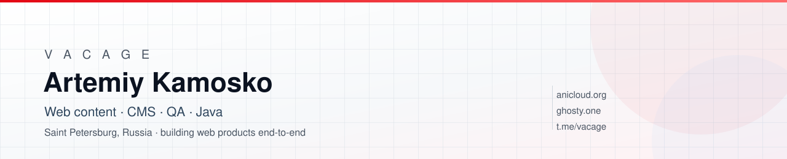

<picture>
  <source media="(prefers-color-scheme: dark)" srcset="assets/banner-dark.svg">
  <source media="(prefers-color-scheme: light)" srcset="assets/banner-light.svg">
  
</picture>

### Web content, CMS and QA - with Java and AI in the toolkit

I build and run web products end-to-end: page content and knowledge bases, admin panels and publishing workflows, catalogues and reference data, testing after release. Most of the code lives in private repositories - the products are public.

---

## What I work on

| Area | What it means in practice |
|---|---|
| **Content & CMS** | Page structure, content collections and field schemas, visual editor, media library, draft → publish, version history and rollback, content validation |
| **Reference data & catalogues** | Product and service catalogues, prices and descriptions, structured data in JSON/YAML/CSV, consistency checks across site and app |
| **QA & release checks** | Content and layout verification on desktop and mobile (320-1920 px), DevTools console/network, HTTP route checks, regression, bug reports with reproduction steps |
| **Java & game backends** | Paper/Purpur plugins, modular plugin architecture, Maven builds, ProGuard, packet-based UI, resource packs |
| **AI-assisted development** | Task specs with acceptance criteria, agent orchestration (Claude Code, Codex, DeepSeek Harness), reviewing and verifying generated results |

## Selected products

| Product | What it is | Stack | Link |
|---|---|---|---|
| **Anicloud** | Game platform: website, knowledge base and admin panel, shop, player profiles, global search | Laravel, Vue, Astro, SQLite, Vite | [anicloud.org](https://anicloud.org) |
| **Ghosty** | Subscription network service: website, account area, plans and billing, admin | Next.js, Node, Kotlin | [ghosty.one](https://ghosty.one) |
| **ExCore** | Modular plugin core for Paper: 69 modules, config-driven lifecycle, reload without restart | Java 21, Maven, ProGuard | private |
| **Excalibur MMORPG** | Game systems, content pipeline, player rig and animations for a Dark Souls-style server | Java, Purpur, MMOCore, Blockbench | private |
| **utility-hub** | Browser tools: pixel-art editor and skill-tree editor with export | React, Vite, Tailwind | - |
| **AnimeOn Helper** | Chrome MV3 extension: state machine, storage, real-browser tests | JavaScript, Manifest V3 | private |

## Stack

**Core**

**Web**

**Tooling and AI**

### Everything I have worked with

| Area | Tools and technologies |
|---|---|
| Markup and styles | HTML5, CSS3 (flex, grid, media queries, design tokens), Markdown, MDX, semantic markup, accessibility basics |
| Languages | JavaScript, PHP, Java 21, TypeScript (reading and edits), Kotlin (edits), Python, SQL, Bash, PowerShell, GLSL (core shaders) |
| Frontend | Vue 3, React 19, Astro 5, Vite, Tailwind CSS, Pinia, Vue Router, framer-motion, component libraries |
| Backend and data | Laravel, Node.js, Express, PHP-FPM, REST API, JSON, YAML, XML, CSV, MySQL, MariaDB, SQLite (WAL), PostgreSQL basics |
| Game servers | Paper and Purpur API, Velocity, Maven, Gradle, ProGuard, packet-based UI, resource packs, Blockbench, ModelEngine, MMOCore, MMOItems, MythicMobs, Nexo |
| Infrastructure | Linux (Debian, Ubuntu), nginx, systemd, Docker, Pterodactyl and Wings, Cloudflare, Let's Encrypt and certbot, SSH, S3 and MinIO, restic backups, monitoring |
| QA and tooling | Chrome DevTools (Elements, Console, Network, device emulation), Playwright, Vitest, PHPUnit, Git and GitHub, Chrome MV3, HTTP and API checks, grep, sed, jq |
| Design and media | Photoshop, After Effects, Blockbench, pixel art, UI mockups, OBS, resource pack assets |
| AI-assisted development | Claude Code, OpenAI Codex, DeepSeek Harness, MCP servers, graphify, llama.cpp and llama-swap with local Qwen models, prompt engineering, agent orchestration and review |
| Office and docs | Word, Excel (formulas, lookups, tables), Google Sheets, 1C, Markdown documentation, runbooks, checklists, Jira and Confluence basics |

## Currently

- Closing the gaps for a content-manager role: HTML/CSS, Word/Excel, QA fundamentals and Git courses (Stepik), with certificates.
- Writing a reusable content-QA checklist: what to verify on a page before and after publishing.
- Keeping a 129-document project knowledge base: deployment, rollback, backups, incident notes.

## Contacts

<b>По-русски / In Russian</b>

### О себе

Строю и веду веб-продукты полного цикла: контент страниц и базы знаний, админ-панели и публикация, каталоги и справочники, тестирование после релизов. Большая часть кода - в приватных репозиториях, публично доступны сами продукты.

**Направления:** контент и CMS, справочники и каталоги, тестирование и приёмка, Java-плагины для Paper, ИИ-ассистированная разработка.

**Проекты:** Anicloud (сайт, база знаний и админка, магазин, профили, поиск), Ghosty (сайт и кабинет сервиса по подписке), ExCore (69 модулей на Java 21), Excalibur (игровые системы, контент, анимации), utility-hub (редактор пиксель-арта и редактор дерева навыков), AnimeOn Helper (расширение Chrome MV3).

**Сейчас:** закрываю профильные курсы по HTML/CSS, Word/Excel, тестированию и Git (Stepik), пишу чек-лист проверки контента, веду базу знаний по проектам.

**Контакты:** Telegram [@vacage](https://t.me/vacage) · vacageinc@gmail.com

---

Most repositories are private; selected work is shown through public products and this profile.

<!-- updated 2026-11-23 -->
